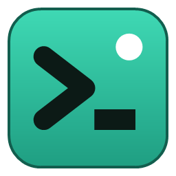

  

# SSH Toolkit

One-click SSH to the NAS, the server and the laptop, with quick commands, key setup, file copy and Docker shortcuts.

    

## ✨ Features

SSH Toolkit is a PowerShell/WPF tool that keeps your home machines (a NAS, a Linux server, a laptop, VMs) in one list and does the everyday SSH jobs with one click:

- **Saved machines**: name, address, port, user and compose folder for each one. Add them with **Add**, and change an address that has moved (a VM, say) with **Edit**.
- **Which ones answer**: a green or red dot beside each machine, checked when the window opens, every minute after that, and on **Check now**. It only tests that the SSH port answers, so it's quick and never signs in.
- **One-click connect**: **Open terminal** (or double-click a machine) opens an SSH session to it in a terminal window.
- **Quick commands**: **Disk space**, **Uptime** and **Docker ps**, with the answer shown in the window, and **Restart machine** (asks first, then opens a terminal for the sudo password).
- **Docker Compose shortcuts**: **Pull**, **Up** and **Down** in the machine's compose folder, using its compose project name when the stack was started under another name, so the right containers are touched. Down asks first.
- **File copy**: **Send files to it...** copies files from this PC to a folder on the machine; **Get a file from it...** copies one back.
- **SSH key helper**: the two commands that set up password-free sign-in, each in its own box with a **Copy** button and a **Run it** button.
- **Run a command**: a box for any other command that doesn't ask questions.
- **Plain-English errors**: "Can't reach NAS", "NAS turned down the sign-in", "this machine's identity has changed" (with a button to forget the old one, for VMs that get a reused address) instead of raw ssh messages.

## 📋 Requirements

- Windows 10 or 11.
- Windows PowerShell 5.1 (built into Windows) with .NET Framework 4.7.2 or later.
- Windows' OpenSSH Client (`ssh.exe`, `scp.exe`, `ssh-keygen.exe`), which is built in. If it's missing: Settings > System > Optional features > OpenSSH Client.
- SSH turned on for each machine. Synology: Control Panel > Terminal & SNMP, the user home service on (Control Panel > User & Group > Advanced) and an administrator account.

## 📦 Installation

1. Download `SSH-Toolkit-v1.00.zip` from the [latest release](../../releases/latest) and unzip it wherever you like to keep it.
2. Double-click **SSH Toolkit.cmd** in the unzipped folder. It makes an **SSH Toolkit** shortcut there and in the Start menu, and starts the tool. From then on, use the shortcut, the Start menu, a pinned taskbar button or the Home Launcher.

Nothing is installed and no Windows settings are changed. The shortcut runs the script with PowerShell's execution policy bypassed for that run only.

**From the repo:** clone it and double-click **Start SSH Toolkit.cmd**.

### Why no exe

Home tools used to ship as PS2EXE exes, and antivirus programs (ESET among them) kept flagging those exes as generic trojans by mistake. A plain script and a shortcut give the same one-click start without the false alarms, and you can read exactly what runs.

### Build a release

Double-click **Build.cmd** in the repo folder. It reads `build.json`, checks every script for syntax errors and that `$script:AppVersion` matches the newest `CHANGELOG.md` entry, runs PSScriptAnalyzer if it's installed, copies the release files into `..\Builds\SSH Toolkit v<version>\`, zips that folder for the GitHub release, refreshes `..\Builds\SSH Toolkit.lnk` (what the Home Launcher starts) and scans the result with ESET's command-line scanner if it's installed.

## 🚀 Usage

1. Start SSH Toolkit and click **Add** for each machine: a name, its address and SSH port, the user to sign in as, and (for Docker) its compose folder. After a moment each machine's dot turns green (answering) or red (can't reach it).
2. **First time only: set up the SSH key.** Pick a machine and click **Key helper**.
   - Step 1 makes a key on this PC (skip it if the helper says this PC already has one).
   - Step 2 copies the key to the selected machine. **Run it** opens PowerShell, which asks for that machine's password once.
   - Do step 2 once for each machine. If you already sign in to a machine with `ssh` and no password, it's the same key, so there's nothing to do.
3. Click **Uptime**. If it answers in the output box, everything works.
4. From then on, pick a machine and click what you need. Commands in the window run in the background, so the window stays usable; **Stop** ends one that takes too long.

Commands in the window never ask for a password (they'd wait for an answer nobody can see), so anything that does ask, like `sudo`, needs **Open terminal**. **Restart machine** already does that for you.

## ⚙️ Configuration

**Where settings live:** everything SSH Toolkit stores is in `%APPDATA%\SSH Toolkit\`. It stays on your PC and is never inside the repo or the `Builds\` folder, so rebuilding or updating can't touch it.

- `settings.json`: the machine list. Change it with **Add**, **Edit** and **Remove**.
- `SSH Toolkit.log`: what was run on which machine, and any errors.

Each machine has:

| Setting | Example (a Synology NAS) | What it's for |
| --- | --- | --- |
| Name | `NAS` | What the list shows. |
| Address | `192.168.1.10` | An IP address works best (some host names don't resolve reliably). |
| Port | `22` | The SSH port (usually 22). |
| User | `admin` | The account to sign in as. |
| Compose folder | `/volume1/docker` | Where `docker-compose.yml` is; Pull, Up and Down run there, and Send files starts there. |
| Compose project | `media` | Only if the stack was started under a name other than the folder's (Synology Container Manager uses the project's name). |

The key is Windows' usual one, `%USERPROFILE%\.ssh\id_ed25519`, so `ssh` in any terminal and other tools use it too. SSH Toolkit never stores a password.

## 📝 Changelog

See [CHANGELOG.md](CHANGELOG.md).

## 📄 Licence

[MIT](LICENSE). Copyright (c) 2026 Jason Rhodes.

Created by Jason Rhodes, built with Claude (Anthropic).
